<div align="center">


<br/>

<a href="https://syedraqi.github.io/portfolio/"></a>

</div>



This is the source code of my personal portfolio website, published with **GitHub Pages** at **<https://syedraqi.github.io/portfolio/>**.

The site's code lives in the [`app/`](app) folder, and its automation lives in [`.github/workflows`](.github/workflows).



| Project | What it is |
| :--- | :--- |
| 📚 [**ILMS**](https://github.com/SyedRaqi/ILMS) | An Integrated Library Management System built with Flask and SQLite: a book catalog, loans with fines, reservation queues, and member, librarian and admin roles. |
| 🕌 [**MDC**](https://github.com/SyedRaqi/MDC) | A bilingual English and Urdu community newsroom for Madeena Welfare Society, Bhatkal, built with Next.js and Supabase, with an admin CMS. |
| ✦ [**More on GitHub**](https://github.com/SyedRaqi?tab=repositories) | Everything else I am working on. |



These are the tools used across the projects above.



```text
portfolio/
├── .github/
│   └── workflows/     # GitHub Actions workflows
└── app/               # The site's source code
```



```bash
git clone https://github.com/SyedRaqi/portfolio.git
cd portfolio/app
```

From there, follow the install and start steps for the framework used in `app/`.


The site is served by **GitHub Pages** and is live at <https://syedraqi.github.io/portfolio/>. The workflow files in [`.github/workflows`](.github/workflows) define the repository's automation.


- 🐙 **GitHub:** [github.com/SyedRaqi](https://github.com/SyedRaqi)
- 🌐 **Live site:** [syedraqi.github.io/portfolio](https://syedraqi.github.io/portfolio/)

